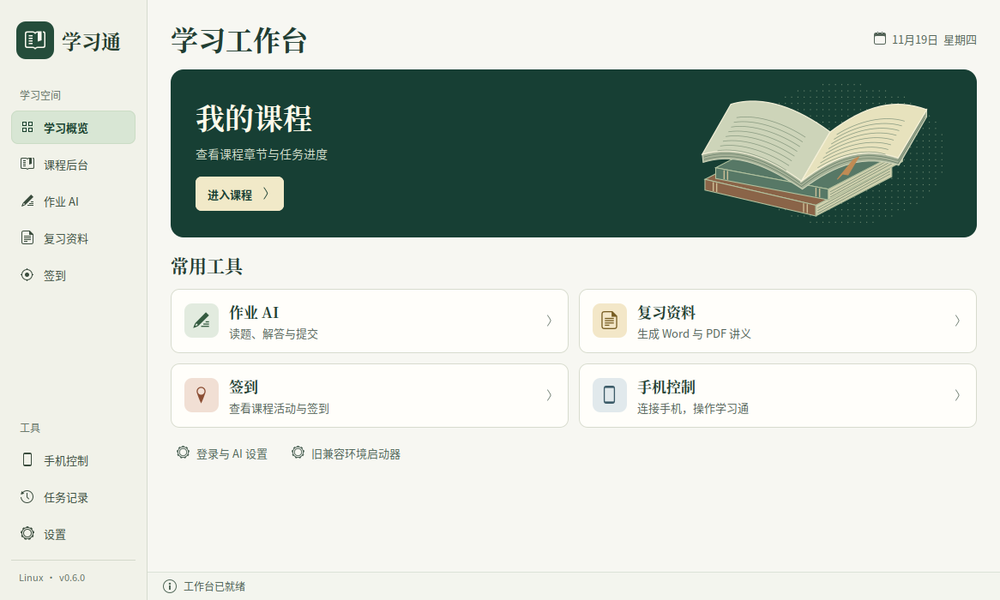

# 学习通 Linux 工作台 · 0.6.0

面向学习通用户的 GTK 桌面工作台。首页可进入课程、作业、复习资料和签到，侧栏可随时切换页面。课程服务使用独立的 Python 3.13 后端，手机控制通过已授权的 USB 设备连接。

手机连接与网站登录是两个独立入口。普通 USB 调试不能读取正式版学习通的私有登录文件；本项目自动复用本机Firefox或原有学习后端的有效网页会话，另保留备用导入入口，不声称已提取手机内部消息接口或绕过设备验证。



## 功能及验证范围

| 功能 | 实现情况 |
|---|---|
| 作业 AI | 从学习通读取课程作业列表、选择后读题、联网搜索、模型解答、编辑答案、保存草稿/正式提交、一键完成。未知答案或搜索核验失败时暂停自动流程。 |
| 复习资料 | 选择课程后按需调用已配置的 AI，整理章节、作业和资料，生成同一套 Word 和 PDF。 |
| 课程后台 | 课程列表、只读计划、视频/音频回退、文档、阅读、空章节和章节测验队列；实时进度、停止、逐项回读核对。 |
| 签到 | 学习通活动列表与状态筛选、时间和人数详情；地图搜索/选点、常用位置、九宫格手势、专用参数输入和本地签到历史。照片、人脸和新的验证机制需官方应用处理。 |
| 手机控制 | 选择 USB 手机、拉起学习通、预览画面、点击、滑动、按键、英文数字输入，也可打开独立 scrcpy 窗口。 |
| 任务与设置 | 私有配置、任务历史、错误提示、取消、重复写任务拦截、关窗回收任务进程。 |

2026-11-10 完成离线协议、界面和安装测试，并检查本机 Python 3.13 后端及 USB 连接。**未使用真实账号执行作业提交、签到或刷课写入，也未配置用户的付费 AI 密钥进行实际解题。** 编码支持与线上验证分开记录，完整边界见 [功能和验证清单](docs/FEATURES.md)。

## 本机开始使用

在应用菜单打开 **学习通 Linux**，或执行：

```bash
~/.local/bin/chaoxing-linux
```

### 读取学习通与配置 AI

在「设置」页面同步学习通，并配置AI：

1. 点击「同步学习通登录状态」或「刷新课程」，自动复用本机已登录会话。首次使用或会话失效时，在本机 Firefox 打开学习通官网，用官方扫码登录后再同步；无需在工作台填写账号密码。账号密码和手动Cookie导入只作为折叠备用入口。
2. 使用 ChatGPT 时，打开「设置 → AI 服务」，选择「ChatGPT 官方账号授权」，点击「使用 ChatGPT 继续」，在浏览器登录并授权套餐用量。支持符合条件的套餐。使用 DeepSeek 或其他兼容服务时，选择 API Key 方式并填写服务地址与模型。
3. 联网模式默认「模型调用搜索工具」：勾选允许联网后，模型可自行调用搜索；搜索后端可用 `bing_rss`（无需Key）、`duckduckgo` 、`tavily` 或 `deepseek`。也可选择「模型原生联网」，需要模型服务支持 Responses 的 `web_search`；此模式不使用本机搜索Key。允许联网不保证模型每题都会搜索，结果显示实际调用和来源。点击「测试 AI 连接」只测试模型API，不会发起搜索。

DeepSeek官方Flash填 `https://api.deepseek.com`、`deepseek-flash`，联网选「模型调用搜索工具」。它的API不支持原生 `web_search`；可使用现有搜索服务，也可选官方DeepSeek搜索，详见 [AI配置说明](docs/AI-PROVIDERS.md)。

已有课程后端的用户可在「设置 → 课程组件」指定源码与解释器路径。旧 Cookie 仅复制到新数据目录，原文件不改动；有效性以「刷新课程」结果为准。新学习通会话可从浏览器同步；AI密钥在本机设置填写，不需要写入源码。

### 完成作业

在「作业 AI」刷新课程、选择课程并读取作业列表，选择实际作业后读题。链接由学习通返回，不需要手动复制；「高级」中仍可打开已有链接。

1. 「读取题目」检查所选作业题目；「AI 解答」生成参考答案并列出实际检索来源。
   题干与选项中的图片会一并读取，可展开预览；解题时直接发送图片字节给模型，不做OCR。界面分别显示载入数量和随模型请求发送的数量。读取失败、附件缺失、缓存改变或模型拒绝图片时停止自动保存/提交，不能降级为残缺文字作答。支持格式与限制见 [题图说明](docs/IMAGE-QUESTIONS.md)。
2. 双击答案可以修改；多选/填空数组等复杂答案可通过「编辑完整作业数据」编辑 JSON。
3. 「保存草稿」与「正式提交当前答案」分别对应平台的保存和提交操作。
4. 「一键完成」会依次读取、解答并保存；允许联网时，模型可调用已选方式搜索。勾选「一键完成后正式提交」才会直接正式提交。

允许联网由模型决定是否使用；未调用搜索会标注为自身知识回答。未知答案或实际搜索失败、引用无法核验时停在可编辑结果。搜索失败也会显示真实状态；搜索引用和结构校验不保证答案正确。验证码、未开放、已截止、加密字体解析失败、无法识别的多空字段会明确提示。

### 导出课程复习资料

先在「设置 → AI 服务」保存 AI 配置。打开「复习资料」，选择课程和保存目录，再点击「用 AI 生成 Word 和 PDF」。工作台这时才读取课程并调用模型，成功后将两份文档保存到同一子目录。打开页面和刷新课程列表不会生成备份。

导出需要 LibreOffice Writer。中文字体推荐 Noto CJK。PDF 资料文字提取使用 `pdftotext`，旧版 DOC/PPT 可选安装 `antiword` / `catdoc`。具体收录范围见 [课程复习资料](docs/COURSE-REVIEW.md)。

### 课程后台

先刷新并选择课程，再查看只读执行计划。点击「后台执行课程」开始队列；页面切换不停止任务，关闭整个工作台会请求停止并回收后端进程。

勾选「AI 处理章节测验」后才会调用解题；勾选「正式提交章节测验答案」后才会提交，否则保存草稿。自动正式提交要求答案通过题型校验；如果实际使用了搜索，须有可核验来源。保存草稿不计作完成测验。

完成状态以远端回读为依据：`reported` 表示请求被接受但尚未核对完成，不代表获得课程分。讨论、直播、实训、教师自定义活动等未覆盖类型会列为不支持或待处理，不能承诺自动取得所有课程分。

### 签到与是否能够不在场签到

在「签到」选择课程并刷新活动，按「全部 / 进行中 / 已结束」筛选，再选择活动。页面显示学习通返回的名称、方式和状态，展开详情查看开始/截止时间与人数。已明确结束的活动不能提交，未知状态保持标注。

位置签到可打开「地图选点」：搜索学校或校区、从候选列表选择、拖动缩放并点击地图，确认后回填表单；也可保存为常用位置，之后选择复用。常用位置标签只用于本机，提交地址另行填写。地图确认和保存位置都不会签到，最后核对课程、活动及参数，再点击提交；历史页显示本机最近80条签到任务结果。手势签到使用九宫格输入。详见 [地图使用说明](docs/MAPS.md)。

微信小程序仅参考界面交互，真实课程、活动数据及签到请求直接使用学习通接口，不请求小程序服务。活动列表已用当前学习通会话只读验证；提交接口及各签到参数仍需逐类线上验证，来源与验证状态见 [学习通接口依据](docs/ATTENDANCE-API.md)。接口能否成功取决于活动规则和服务器验证。

- 普通签到：无需额外现场资料时，客户端可以提交签到请求。
- 签到码/手势：需要正确的数字码或手势序列。
- 二维码：需要当前有效的二维码内容或 `enc`；动态二维码可能过期。
- 位置：需要经纬度和地址；提交坐标不等于通过服务器的设备/位置验证。
- 照片、人脸、验证码及其他验证：使用官方应用完成。本项目没有伪造照片、人脸、设备证明或修改手机 GPS。

请求成功只按服务器明确返回记录；没有执行真实现场/远程签到对照测试。参考来源和条件见 [功能说明](docs/FEATURES.md)。

### 手机控制

手机启用 USB 调试，解锁并允许这台电脑连接。在「手机控制」选择设备，点击「在手机上打开学习通」，再刷新预览；也可打开独立手机窗口。

预览和点击仅在官方学习通处于前台时执行，避免读取其他应用画面。输入框的 ADB 方式支持英文、数字及符号；中文请使用手机键盘或独立手机窗口。相机、定位和手机登录仍由原应用提供。独立 scrcpy 窗口与工作台任务分开管理。

## 安装与更新

已验证 Ubuntu 24.04 / Intel x86_64。源码安装命令在克隆后的仓库根目录执行。

```bash
sudo apt install python3 python3-gi gir1.2-gtk-3.0 python3-dbus python3-cryptography python3-gi-cairo
bash scripts/install-local.sh
~/.local/bin/chaoxing-linux
```

系统安装可从 [GitHub Releases](https://github.com/klbbs/linux_chaoxin/releases) 下载对应版本的 deb 和 SHA256SUMS。在下载目录执行：

```bash
sha256sum -c SHA256SUMS
sudo apt install ./chaoxing-linux_0.6.0_all.deb
```

手机模式第一次使用点击「安装手机连接工具」，或普通用户执行 `python3 scripts/install-phone-tools.py --apply`。固定 scrcpy 5.0.1 官方 x86_64 归档经过 SHA256 核对，已有系统 ADB 优先复用。

新机器的账号功能需要独立 Python **3.13** 环境。可以在设置中指定已有开源项目的源码和解释器，或使用「安装课程服务组件」安装固定版本后端：

```bash
python3 scripts/install-study-backend.py
python3 scripts/install-study-backend.py --apply --python /absolute/path/to/python3.13
```

不带 `--apply` 只显示计划。安装器保留上游完整源码、资源和 LICENSE，核对固定源码归档 SHA256，并安装锁定依赖；首次依赖安装较大。它不会覆盖原 `chaoxing/` 环境。未找到 Python 3.13 时会明确提示，不自动变更系统 Python。

源码更新后重新运行 `scripts/install-local.sh`；系统安装重新构建并安装 deb。deb 的 `Architecture: all` 指 Python 启动器，手机工具仍有 x86_64 限制。

## 版本管理

自 `v0.5.2` 起，稳定版本在 `main` 上使用 `v主版本.次版本.修订号` 标签。早期版本的变化见 [更新记录](docs/CHANGELOG.md)。

发布前更新 `src/chaoxing_linux/__init__.py` 中的版本号和更新记录，运行下方测试并构建 deb。打包脚本直接读取应用版本。维护者在通过验证的提交上创建附注标签，与 `main` 一起推送。GitHub 会核对标签、应用和安装包版本，并在 Releases 提供安装包及 SHA256 校验文件。

## 开发与命令

```bash
PYTHONDONTWRITEBYTECODE=1 PYTHONPATH=src python3 -m chaoxing_linux
PYTHONDONTWRITEBYTECODE=1 PYTHONPATH=src python3 -m unittest discover -s tests -v
bash scripts/build-deb.sh
chaoxing-linux --study-status
chaoxing-linux --phone-devices
chaoxing-linux --phone
chaoxing-linux --stop-phone
chaoxing-linux --legacy-launcher
```

`--study-status` 只检查本地组件，不登录账号；`--doctor --json` 继续用于实验兼容环境检查。`--legacy-launcher` 打开原 Waydroid 启动器；它仍不能独立正常运行已测试的官方学习通版本，见 [Waydroid 文档](docs/WAYDROID.md)。

## 目录、数据与日志

| 位置 | 内容 |
|---|---|
| `src/chaoxing_linux/workspace.py` | 电脑工作台 |
| `service.py` / `study_backend.py` / `study_worker.py` | 设置、任务管理与独立课程后端协议 |
| `assistant_ai.py` / `phone_control.py` | 搜索解题及手机操作 |
| `location.py` / `map_picker.py` | 坐标、公开地点搜索、地图选点 |
| `session_sync.py` | 只读发现学习通已有网页会话；独立验证后同步 |
| `scripts/` / `tests/` / `dist/` | 安装工具、离线测试、安装包 |
| `~/.config/chaoxing-linux/settings.json` | 当前用户账号/API 配置；权限 0600 |
| `~/.local/share/chaoxing-linux/study-data/` | 独立 Cookie、任务记录、常用位置与签到历史；私有权限 |
| `~/.local/share/chaoxing-linux/study-backend/` | 可选独立后端的 source 与 .venv |
| `$XDG_RUNTIME_DIR/chaoxing-linux/` | 手机预览、手机和兼容模式运行日志 |

主项目使用系统 Python/GTK，不将第三方后端导入 GTK 主进程。账号、密钥不放在子进程命令行，任务记录经过脱敏；任务中断后不会在下次启动时自动重放提交。完整架构见 [ARCHITECTURE](docs/ARCHITECTURE.md)，AI 配置见 [AI-PROVIDERS](docs/AI-PROVIDERS.md)，本次测试见 [0.6.0 界面与发布验证](docs/validation/release-0.6.0.json)。

## 卸载

先关闭工作台及独立手机窗口。用户目录版本删除以下专用入口和程序目录：

```bash
rm -f ~/.local/bin/chaoxing-linux
rm -f ~/.local/share/applications/chaoxing-linux.desktop
rm -f ~/.local/share/icons/hicolor/scalable/apps/chaoxing-linux.svg
rm -rf ~/.local/share/chaoxing-linux
```

这些步骤会删除程序目录内的任务数据和可选后端；配置仍在 `~/.config/chaoxing-linux/`，下载缓存仍在 `~/.cache/chaoxing-linux/`。需要保留任务记录时先备份。系统版本使用 `sudo apt remove chaoxing-linux`；用户数据、手机原应用、原 `chaoxing/` 工具和 Waydroid 不随 apt 卸载删除。自定义 XDG 路径时按实际安装位置处理。

## 后续安卓端

用户提出的「学习通2.0」安卓端暂未开发。必须先完成Linux版修复，经用户审阅并明确同意后再启动；本次没有创建APK、申请高权限、安装抓取服务或改变手机权限。

## 来源

课程后端固定 [Samueli924/chaoxing](https://github.com/Samueli924/chaoxing) 的 `45d2106b16764231c2de2038fb042e71b23d878f`，上游 LICENSE 保留；签到参数另外对照 [MetaQiu/xxtSignApi](https://github.com/MetaQiu/xxtSignApi)。手机工具来自 [scrcpy 5.0.1](https://github.com/Genymobile/scrcpy/releases/tag/v5.0.1)，原应用来自 [官方学习通](https://app.chaoxing.com/)。

安装包包含工作台源码、安装脚本和图标，不含学习通 APK/DEX、反编译源码、账号 Cookie 或 API 密钥。本次实现和验证范围见 [FEATURES](docs/FEATURES.md)。
