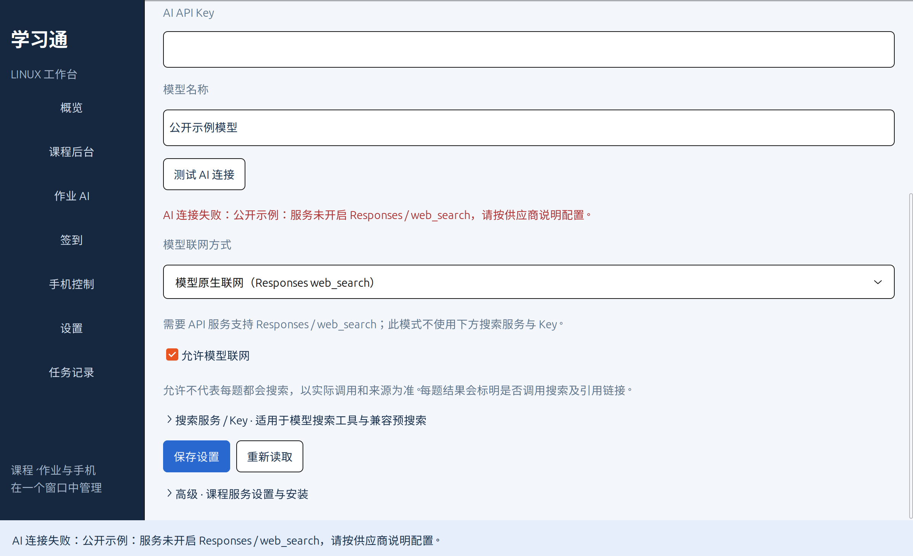
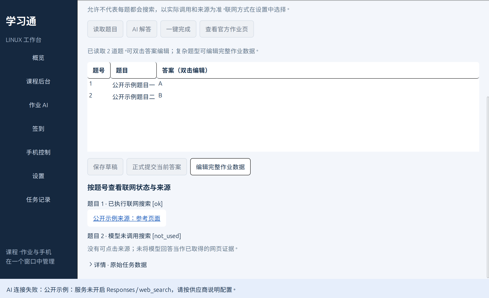

# AI 解题与联网资料

此模块接收题干、选项和已验证的题图，向用户配置的模型服务请求答案；允许联网时，模型可自行使用搜索工具或原生联网。它不读取手机、账号、Cookie、学习通消息或登录凭证，也不负责提交作业。正式提交由调用方处理；`status: unknown` 的结果必须阻止提交。

## 服务配置

| 配置项 | 含义 |
| --- | --- |
| `api_base` | 支持 Chat Completions 的服务地址，可填服务根地址、`/v1` 地址或完整 `/chat/completions` 地址 |
| `api_key` | 服务密钥；本地无鉴权模型可留空 |
| `model` | 服务提供的准确模型名称，必须填写 |
| `search_enabled` | 是否允许模型联网，默认 `true`；允许不等于每题强制搜索 |
| `search_mode` | `tools`（默认，模型调用搜索工具）、`native`（服务内置web_search）、`prefetch`（兼容预搜索） |
| `search_provider` | `bing_rss`（默认，无搜索密钥）、`duckduckgo`（无搜索密钥）、`tavily` 或 `deepseek` |
| `search_key` | Tavily/DeepSeek搜索密钥；DeepSeek官方模型可复用同站模型Key |
| `request_timeout` | 单次网络请求超时秒数，默认 30，可设 1–120 |
| `max_retries` | 临时网络错误、HTTP 429、500、502、503、504 的重试次数，默认 2，范围 0–3 |

所有模型及搜索请求拒绝 HTTP 重定向，避免密钥被转发到其他域名或明文地址；请直接填写最终服务端点。远程模型地址要求 HTTPS；本机 `localhost`、`127.0.0.1`、`::1` 可使用 HTTP。地址不能带账号密码、查询参数或片段，密钥请单独填写。自定义代理路径支持服务根地址后自动附加 `/v1/chat/completions`；如果供应商路径不同，填写完整 `/chat/completions` 地址。

客户端使用 Python 标准库，兼容 `POST /v1/chat/completions` 的 `model`、`messages`、`temperature` 和 `response_format: {"type":"json_object"}`。供应商返回 HTTP 400 / 422 时会去掉 `response_format` 重试一次，仍严格验证回复是否为 JSON。流式回复和仅支持其他协议的端点不适用。

Bing RSS 使用 `https://cn.bing.com/search?format=rss` 返回的公开 RSS，无需搜索密钥；直接请求该域名以避免自动地区重定向。提取实际返回的 HTTP(S) 结果链接、标题和摘要，拒绝 DTD、实体声明及非 RSS 响应。公开搜索渠道可能变化、限流，结果的相关性也会随查询而变，不能保证找到题库或正确答案。

DuckDuckGo 使用公开 HTML 搜索页面，可能出现限流、验证码或无结果。检测到验证表单、异常挑战或无法识别的页面时明确记录 `failed`，不尝试绕过；只有明确的无结果页面才记录 `empty`。Tavily 使用其搜索接口，仅发送题目查询，关闭生成式答案与网页原文下载。搜索结果保留最多 5 条，每条包含标题、URL 和摘要，不下载或执行结果页面。

## 联网方式

- `tools`：给模型提供 `web_search` 函数，模型决定何时查询及查询词；程序执行搜索并把实际结果作为工具消息交回模型，最多3轮、5次。不是每题固定先搜一次。
- `native`：使用支持Responses的模型服务内置 `web_search`。调用记录及引用从服务返回的元数据取得，模型正文自称“已联网”不算证据。
- `prefetch`：显式保留旧版兼容流程，由程序先搜索再解题。

原生工具与函数调用格式分别依据 [OpenAI Web search](https://developers.openai.com/api/docs/guides/tools-web-search)、[Function calling](https://developers.openai.com/api/docs/guides/function-calling)。服务不支持所选模式时明确报错，不静默换成无联网聊天。

### 使用 ChatGPT 账号

在设置中点击「使用 ChatGPT 继续」，在 OpenAI 官方浏览器页面登录、选择工作区，并允许本应用使用 ChatGPT 套餐。授权后可在设置中切换账号并选择相应账号的可用模型。「测试 AI 连接」会请求一条短回复。支持与用量取决于 ChatGPT 账号的套餐和权限。[OpenAI 官方账号授权说明](https://developers.openai.com/siwc/token-sharing-open-source)

账号模式使用官方的本机应用 OAuth 授权与模型目录。课程复习在点击生成后才发送课程文字，使用官方 Responses 流式接口并等到任务完成。作业的联网开关控制原生搜索。授权由本机工作台单独管理，可用「退出授权」停止使用，或在 ChatGPT 设置中管理套餐用量。[OpenAI 模型与请求说明](https://developers.openai.com/siwc/token-sharing-open-source/models-and-inference)

如需使用 OpenAI 平台的 API Key，在设置的 API Key 区域选择「OpenAI API Key 配置」。账号授权和 API Key 是两种可独立选择的方式。

### DeepSeek官方Flash

地址填 `https://api.deepseek.com`，模型名 `deepseek-flash`。官方Flash支持函数工具调用，但忽略Responses内置 `web_search`，因此使用 `tools`；内置搜索的模型限制见 [DeepSeek Responses说明](https://api-docs.deepseek.com/guides/responses_api/)，模型名见 [官方入门](https://api-docs.deepseek.com/en/)。

搜索服务可沿用免费的 `bing_rss`；选择 `deepseek` 时调用官方 `/v1/tools/search`，与模型共用官方Key，搜索请求按供应商规则计费。第三方模型网关不能自动复用Key到DeepSeek，需单独填写搜索Key。实际查询限128个Unicode字符、每次最多5条，见 [DeepSeek搜索文档](https://api-docs.deepseek.com/guides/search/)。

设置页的DeepSeek配置按钮只填写地址、模型与搜索模式等，不读取或清空Key，不保存或自动调用API；修改后按需保存和测试。思考模式工具续轮保留服务要求的 `reasoning_content`，不关闭思考或把内部思考内容展示为答案，依据 [DeepSeek思考工具说明](https://api-docs.deepseek.com/guides/thinking_mode/)。

「测试AI连接」不调用搜索，只验证当前模式的模型API能否响应；成功不代表已搜索、搜索Key有效或作业答案正确。失败原因直接显示在设置页。





## 调用接口

```python
from chaoxing_linux.assistant_ai import AIClient, AICancelled

client = AIClient({
    "api_base": "http://127.0.0.1:8000/v1",
    "api_key": "",
    "model": "your-model",
    "search_provider": "bing_rss",
    "search_mode": "tools",
    "search_enabled": True,
})
connection = client.test_connection()  # {"ok": True, "model": "..."} 或含 error

questions = [{
    "id": "question-1",
    "type": "single",
    "text": "下列哪个数是偶数？",
    "options": [{"key": "A", "text": "1"}, {"key": "B", "text": "2"}],
}]
answers = client.solve_questions(
    questions,
    search=True,
    progress=lambda done, total, result: print(done, total, result["status"]),
    # cancel 可传 threading.Event 或返回 bool 的无参函数
)
```

请求应放在后台线程执行。`progress(done, total, result)` 在每题完成后调用，调用方应自行切回界面线程更新 UI。取消抛出 `AICancelled`，请求中的连接会在当前网络超时内结束，退避等待可立即取消。每批最多 500 题；顶层参数格式错误或重复题号抛 `ValueError`。

每道题发送 `id`、`type`、`text`、`options`，有图时另发送题图及其题干/选项关联；本地路径、缓存hash、原图URL和会话信息不进入模型题目数据或搜索查询。其他调用方元数据丢弃。题号必须为非空字符串或整数。支持题型与答案格式：

| 题型 | `answer` |
| --- | --- |
| `single` | 已存在的选项 `key` 字符串 |
| `multiple` | 已存在且不重复的 `key` 数组，按原选项顺序返回 |
| `judge` | `true` 或 `false`；模型返回明确的“正确/错误”等值时转为布尔值 |
| `fill` | 非空字符串或非空字符串数组 |
| `text` | 非空字符串 |

另兼容后端旧题型名 `completion`、`judgement`、`shortanswer`，并支持“单选题”“多选题”“判断题”“填空题”“简答题”等中文别名；不支持的题型返回 `unknown`，不会猜测题型。填空数量、材料阅读题分组及平台特定填表方式应由调用方进一步处理，本模块不推断缺失的题目内容。

## 图片直传（0.4.2）

DeepSeek官方 `deepseek-flash` 支持图片，格式依据 [官方Vision说明](https://api-docs.deepseek.com/guides/vision/)；选择其他服务时须使用支持图像输入的模型。当前已知不支持图片的官方 `deepseek-v4-pro` 会提前返回 `unknown`，其他服务的拒绝响应也会明确失败，不去掉图片重试。

作业后端借助原学习通会话取得图片并缓存；AIClient只读取通过目录、权限、格式和SHA256检查的图片。调用时设置本地 `data_dir`，题目 `images` 为后端返回的附件描述。Chat Completions以 `image_url` 的base64 data URL传递实际图片，Responses以 `input_image` 传递；关闭联网、模型调用搜索工具及预搜索等模式都保留图片。无需OCR或单独视觉服务。

返回的 `image_status` 含 `state/count/ready/sent`，其中 `sent` 表示收到对应模型请求的成功响应，不证明模型正确理解了图片。请求失败、缺图或图片改变时答案为 `unknown`；答案未知，即便图片已发送也不能提交。图片base64仅存在于模型请求中，不写入任务记录。搜索服务只接收文字查询。

完整缓存结构、下载限制、预览和提交检查见 [题图说明](IMAGE-QUESTIONS.md)。

## 返回结构与提交约束

```json
{
  "id": "question-1",
  "answer": "B",
  "confidence": 0.92,
  "reason": "2 能被 2 整除。",
  "sources": [],
  "status": "ok",
  "search_status": {
    "state": "empty",
    "provider": "bing_rss",
    "count": 0
  }
}
```

`search_status.state` 为 `disabled`、`not_used`、`ok`、`empty` 或 `failed`；`not_used`表示模型未选择搜索，`calls`记录实际调用，失败时另有脱敏 `error`。搜索失败或无结果后仍允许模型依据自身知识回答，调用方必须展示检索状态；普通“允许联网”不要求每题必须搜索，模型未使用工具仍可依据自身知识作答；搜索失败、缺少可核验引用或未知答案会暂停自动流程供检查。原生引用和工具来源均在界面按题号显示为可点击链接。

`status: ok` 只表示结构校验通过，不代表答案事实正确。`confidence` 是模型自报的 0–1 置信度，调用方应结合阈值、资料和人工预览决定后续操作。错误题号、题型不符、不存在的选项、空答案、非 JSON、无效置信度或虚构链接均返回 `status: unknown`、`answer: null` 和具体原因。

模型引用只能指向本题实际搜索得到的 URL。返回的标题与摘要直接复制搜索结果，忽略模型自己编造的标题与摘要；没有搜索结果时不得输出引用。网页资料通过数据字段提供，并明确要求模型忽略其中的操作指令。对有意操纵模型的资料，这种提示约束仍有局限，故不能将模型输出作为执行命令或请求任意地址的依据。

本模块不把密钥写入磁盘，也不记录 HTTP 响应正文；错误消息会隐藏配置的模型和搜索密钥。上层负责配置文件权限和日志管理。本次修复测试使用本地模拟，不发送真实作业题目、不调用用户付费服务。

```bash
PYTHONPATH=src python3 -m unittest discover -s tests -p 'test_assistant_ai.py' -v
```

## 公开搜索实测（2026-11-10）

在当前机器直接测试：DuckDuckGo 的“二进制补码 原理”查询返回人机验证页面，现明确标记失败；Bing RSS 的“二进制补码 原理”“补码 原码 反码”“牛顿第二定律”均返回 5 条有效链接。第一项查询的部分结果只涉及汉字“二”，说明有结果也可能不相关，不能据此声称答案准确。后两项检索有对应主题的实际来源。

实测未调用模型、付费 API 或用户密钥。
