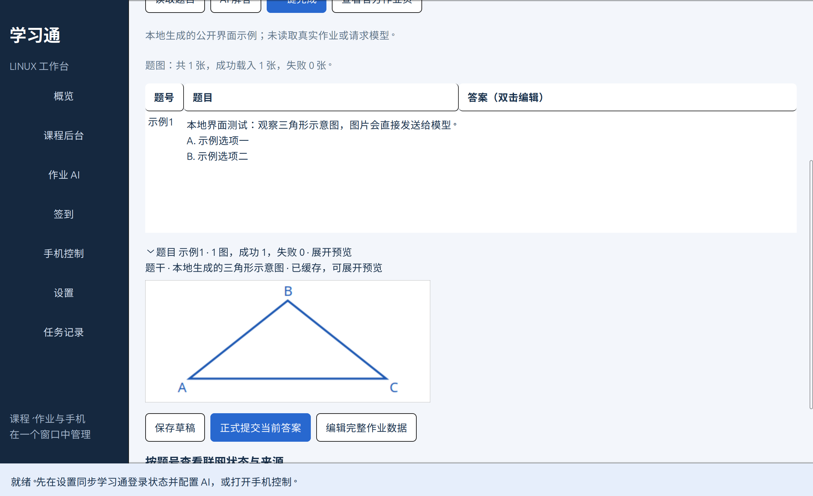

# 作业图片直传 · 0.4.2

读取作业时保留每张图片与题干、选项的对应关系，支持纯图片题干、纯图片选项、公式图、相对链接、懒加载和picture/srcset。图片来源是学习通作业页面；位于已识别题目容器之外的共享材料、CSS背景、canvas和独立附件尚不在自动提取范围，需对照官方页面检查。

## 使用

1. 在「作业AI」选择作业并重新读取题目。旧版保存的数据应重新读取。
2. 查看题图成功/失败数量，展开对应题目的图片预览。
3. 使用支持图片的模型执行AI解答。DeepSeek官方Flash配置保持 `deepseek-flash` 和工具联网模式即可。
4. 检查每题发送图片数、参考答案与来源；「已发送」仅说明模型接口接受了含图请求，不保证识图或答案正确。

图片直接作为图像内容传给所选模型，不经OCR。关闭联网也会发送题图；允许联网时，图片保留在模型工具续轮中，搜索服务只收到文字查询。界面缩略图不改变发给模型的原始图片字节。

## 读取与缓存

- 支持实际内容为PNG、JPEG、GIF、WebP的图片；SVG及伪装为图片的HTML登录页面明确报错。
- 使用现有学习通会话下载，只允许HTTPS的 `chaoxing.com` 及其子域；每次重定向都重新检查，外部CDN目前明确报失败。内联data URL图片可以直接读取。
- 每题最多16张、每张8MiB、合计24MiB；每张下载整体限25秒、请求读取超时最长10秒、最多6次请求。超限图片保留失败条目，不静默删除。预览上限2000万像素，超出时需人工查看。
- 缓存位于 `study-data/assignment-images/`，目录0700、文件0600，按内容SHA256命名；拒绝符号链接、越界路径、不安全权限及内容变化。
- 任务记录只保存附件描述和结果，不保存base64。原图URL仅在本地附件描述中保留，不转给搜索或模型。缓存含作业内容，请按私有学习资料管理；关闭工作台后可清理此缓存，之后须重新读题。

## 阻止残缺作答

任一题图读取失败、缺失、被替换、发送失败或模型不支持图片，均返回未知答案并停止自动完成。保存/提交前再次从学习通读取题目，比较题号、题型、题干、选项、图片位置及内容hash。图片已改变或AI结果缺少完整发送记录时不发送作业写请求；单纯图片URL轮换且内容相同不视为题目变化。

## 验证范围

本版使用生成的公开测试色块、本地HTTP模型服务和模拟学习通响应，验证了实际序列化的图片字节、题目关联、Chat/Responses、工具续轮、关闭联网、预搜索、缓存破坏和提交前变化拦截。GUI测试覆盖预览、失败状态、切换作业清理和按钮拦截。未使用用户Key调用付费模型、未读取新真实作业或提交答案。

协议依据：[DeepSeek Vision](https://api-docs.deepseek.com/guides/vision/)。测试及交付记录见 [0.4.2验证](validation/release-0.4.2.json)。
