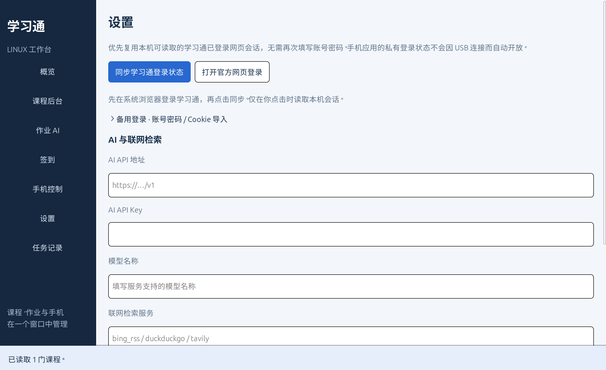
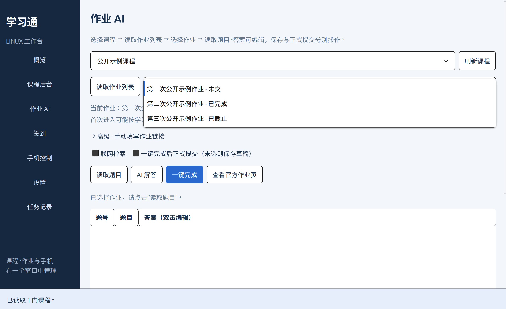

# 直接读取学习通：登录状态与课程作业

0.4.0的主流程不需要手动填写作业链接或学习通账号密码：点击「刷新课程」或在设置中「同步学习通登录状态」，复用本机有效学习通会话；在作业AI页选择课程，读取作业列表，再选择实际作业读题。

## 登录状态从哪里来

程序只读检查本机Firefox（普通安装、Snap、Flatpak）的学习通站点Cookie，以及已配置原后端的 `cookies.txt`，另保留当前工作台会话作为备用。仅处理 `chaoxing.com` 和严格子域，按浏览器配置分开候选，不跨配置合并身份，不读取其他网站、密码库或手机私有文件。Firefox容器/隐私隔离会话不混入普通会话。

每个候选先复制到0700临时目录，禁用账号密码回退，通过学习通读取课程列表验证；有效后才将工作台的会话文件以0600权限原子替换。候选失效或操作取消时不覆盖原工作台会话，也不修改浏览器及原后端文件。当前账号有后台写任务时，先等待或停止任务再切换登录状态。

如果找不到有效会话，在本机Firefox打开 [学习通官网](https://i.chaoxing.com)，使用官方扫码登录后再同步。无需在工作台填写密码；浏览器首次认证仍须由本人完成，不能在没有登录授权的情况下读取账号。系统默认浏览器不是Firefox时，请在Firefox中打开官网。账号密码和Cookie手动导入只作为折叠备用入口。

普通USB调试不能读取正式版Android学习通的私有登录文件；本功能没有声称已经提取手机会话或消息。若手机已登录而电脑尚未登录，仍使用上述官方认证入口完成电脑会话。

## 作业列表

从所选课程的学习通官方页面读取作业入口及其实际参数，再解析官方作业列表与作答/查看链接。签名字段来自平台返回，不从小程序复制、不随意拼造。已提交、未开始、截止等状态按平台实际返回显示，是否能编辑仍以打开的官方作答页面为准。

首次进入尚无作答记录的作业，学习通可能建立作答记录；只选择列表项不会打开题目，须明确点击「读取题目」进入。已完成或不可作答项禁用一键完成、保存和提交，可查看官方页面。

切换课程或作业会清理旧题目，过期的异步结果不能覆盖新选择。已有作业链接仍可在高级区输入，适用于特殊入口，但不是默认流程。模型API及联网配置仍需本人提供，与学习通账号密码不同。

## 验证边界

- 会话发现使用真实SQLite夹具验证本站域过滤、过期、配置隔离及只读行为；服务验证成功/失败、私有文件权限和取消。
- 本机同步验证仅记录来源类型与课程数量，不保存Cookie值和课程名称。
- 作业入口以学习通官方课程页及其脚本为依据；不把离线解析成功等同于线上提交成功。
- 本次只做读取和Linux软件修复，没有提交作业、签到、执行课程队列或开发安卓抓取应用。

用户提出的安卓「学习通2.0」须等Linux版本修复完成、经用户审阅并明确同意后才能开发。本次没有创建安卓项目、APK或高权限服务，也没有更改手机权限。
